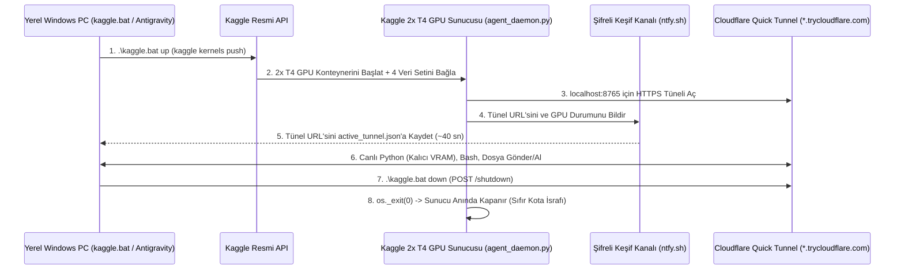

# 🚀 Antigravity – Kaggle 2x T4 GPU Çalışma Akışı (`kaggle_workflow.md`)

Bu doküman, yerel Windows bilgisayarımız (`c:\Users\Tuğhan\Desktop\scRNAseq`) ile Kaggle bulutundaki **2x NVIDIA Tesla T4 (30.7 GB VRAM)** sunucusu arasında kurulan **Antigravity God-Mode GPU Köprüsü**'nün mimarisini ve adım adım kullanım kılavuzunu içerir.

---

## 1. Sistem Mimarisi ve Dosya Yapısı



### Klasör ve Dosya Görevleri
- [`kaggle.bat`](file:///c:/Users/Tuğhan/Desktop/scRNAseq/kaggle.bat): Ana dizindeki tek tuş / tek komut başlatıcı kısayol.
- [`kaggle_bridge/kaggle_ctl.py`](file:///c:/Users/Tuğhan/Desktop/scRNAseq/kaggle_bridge/kaggle_ctl.py): Yerel bilgisayardaki Python kontrol istemcisi ve interaktif Türkçe menü.
- [`kaggle_bridge/kernel/kernel-metadata.json`](file:///c:/Users/Tuğhan/Desktop/scRNAseq/kaggle_bridge/kernel/kernel-metadata.json): Kaggle'a gönderilen sunucu yapılandırması (`NvidiaTeslaT4` çift GPU seçimi ve 4 ana veri setinin otomatik bağlanması).
- [`kaggle_bridge/kernel/agent_daemon.py`](file:///c:/Users/Tuğhan/Desktop/scRNAseq/kaggle_bridge/kernel/agent_daemon.py): Kaggle GPU sunucusu içinde çalışan, tünel açan, kalıcı GPU Python işçisini (`ag_gpu_worker.py`) yöneten ve 20 dakika hareketsizlikte sunucuyu otomatik kapatan (Watchdog) sunucu yazılımı.
- `kaggle_bridge/active_tunnel.json`: Sunucu açıkken aktif Cloudflare tünel adresini tutan geçici dosya (sunucu kapatıldığında otomatik silinir).

---

## 2. Sistemi Çalıştırmanın 3 Yolu

### Yöntem A: Antigravity'ye Söyleyerek (Sıfır Komut / Tam Otonom)
Sohbet ekranından doğrudan ne yapılmasını istediğini söylemen yeterlidir:
- *"GPU sunucusunu aç, scMamba2 kurulumunu yap ve modeli test et."*
- *"Yeni yazdığımız BiMamba bloğunu Kaggle GPU'da çalıştırıp sonuçları indir, sonra sunucuyu kapat."*

Antigravity tüm başlatma, dosya gönderme, çalıştırma, sonuçları indirme ve sunucuyu kapatma işlemlerini kendisi yürütür.

---

### Yöntem B: `kaggle.bat` Dosyasına Çift Tıklayarak (İnteraktif Türkçe Menü)
Proje ana dizinindeki **[`kaggle.bat`](file:///c:/Users/Tuğhan/Desktop/scRNAseq/kaggle.bat)** dosyasına çift tıkladığında (veya terminalde argümansız `.\kaggle.bat` yazdığında) interaktif kontrol paneli açılır:

```text
============================================================
   ANTIGRAVITY - KAGGLE 2x T4 GPU KONTROL PANELİ
============================================================
  [1] GPU Sunucusunu Başlat (up)
  [2] Durum ve Kalan 30 Saatlik Kotayı Gör (status)
  [3] scMamba2 Ortamını Otomatik Kur (setup)
  [4] Canlı Linux (Bash) Komutu Çalıştır
  [5] Canlı GPU Python Kodu / Dosyası Çalıştır (Kalıcı VRAM)
  [6] GPU Sunucusunu Hemen Kapat - Kotayı Durdur (down)
  [0] Çıkış
============================================================
```

---

### Yöntem C: Terminalden (PowerShell / CMD) Komut Satırı ile

Proje ana dizininde (`c:\Users\Tuğhan\Desktop\scRNAseq`) aşağıdaki komutları doğrudan çalıştırabilirsin:

#### 1. GPU Sunucusunu Başlatma (`up`)
```powershell
.\kaggle.bat up
```
- Kaggle'da **2x Tesla T4** sunucusunu başlatır, ~40-45 saniye içinde Cloudflare tünelini yakalar ve canlı GPU durumunu ekrana basar.

#### 2. Kota ve Sunucu Durumunu Kontrol Etme (`status`)
```powershell
.\kaggle.bat status
```
- Haftalık 30 saatlik GPU kotandan kalan süreyi (`remaining`), Kaggle çekirdek durumunu (`RUNNING` / `COMPLETE`) ve tünel açıksa anlık GPU VRAM / sıcaklık bilgilerini gösterir.

#### 3. `scMamba2` Ortamını Otomatik Kurma (`setup`)
```powershell
.\kaggle.bat setup
```
- Sunucu açıldıktan sonra tek komutla:
  1. `torch==2.3.0+cu121`, `torchvision==0.18.0`, `torchaudio==2.3.0` kurar.
  2. `torchtext==0.18.0` (`--no-deps`), `causal-conv1d==1.4.0` ve `mamba-ssm==2.2.2` (`torch2.3` hazır wheel) kurar.
  3. `transformers==4.43.4` ve `scgpt` (`--no-deps`) kurar.
  4. `/kaggle/input/datasets/tughankovucu/sc-mamba2-model/scmamba2` kodunu `/kaggle/working/scmamba2` altına kopyalayıp hatalı `scmamba` importlarını `scmamba2` olarak düzeltir.
  5. Kalıcı GPU Python alt-sürecini (`ag_gpu_worker.py`) otomatik yeniden başlatarak yeni `torch 2.3.0` ortamını **oturumu kapatmadan** devreye alır.

#### 4. Canlı GPU Belleğinde Python Kodu veya Dosyası Çalıştırma (`py`)
```powershell
# Tek satırlık Python kodu çalıştırma:
.\kaggle.bat py "import torch; print('GPU Sayısı:', torch.cuda.device_count())"

# Yerel bilgisayardaki bir Python scriptini doğrudan uzak GPU belleğinde çalıştırma:
.\kaggle.bat py "@test_scmamba.py"
```
> **Kalıcı VRAM Özelliği:** `py` komutuyla tanımladığın değişkenler (`model`, `vocab`, `adata` vb.) GPU belleğinde **silinmeden kalır**. Bir sonraki `.\kaggle.bat py "..."` komutunda modeli veya veri setini baştan yüklemeden aynı değişkenleri doğrudan kullanmaya devam edebilirsin!

#### 5. Linux / Bash Komutu Çalıştırma (`bash` ve `bash_bg`)
```powershell
# Anlık komut çalıştırma:
.\kaggle.bat bash "nvidia-smi"

# Uzun sürecek bir eğitimi arka planda başlatma:
.\kaggle.bat bash_bg "python /kaggle/working/train_bimamba.py"
```

#### 6. Dosya Gönderme ve İndirme (`upload` / `download`)
```powershell
# Yerel bilgisayardan Kaggle sunucusuna dosya gönderme:
.\kaggle.bat upload .\yeni_model.py /kaggle/working/scmamba2/model/model.py

# Kaggle sunucusundan yerel bilgisayara ağırlık/sonuç indirme:
.\kaggle.bat download /kaggle/working/best_bimamba.pt .\checkpoints\best_bimamba.pt
```

#### 7. Sunucuyu Hemen Kapatma ve Kotayı Durdurma (`down`)
```powershell
.\kaggle.bat down
```
- Sunucuya `/shutdown` sinyali gönderir; sunucu 1 saniye içinde kapanır (`KernelWorkerStatus.COMPLETE`) ve **30 saatlik GPU kotasının harcanması anında durur**.

---

## 3. Örnek Uçtan Uca Çalışma Senaryosu

```powershell
# 1. Sunucuyu aç (45 sn)
.\kaggle.bat up

# 2. scMamba2 + Mamba-SSM ortamını kur
.\kaggle.bat setup

# 3. Yerelde düzenlediğin BiMamba model dosyasını sunucuya gönder
.\kaggle.bat upload .\bimamba_test.py /kaggle/working/bimamba_test.py

# 4. Kalıcı GPU belleğinde testi çalıştır
.\kaggle.bat py "@bimamba_test.py"

# 5. Üretilen sonuç/checkpoint dosyasını bilgisayarına indir
.\kaggle.bat download /kaggle/working/results.json .\results.json

# 6. İş bittiğinde sunucuyu kapat (Kotayı koru!)
.\kaggle.bat down
```
