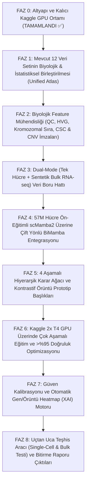
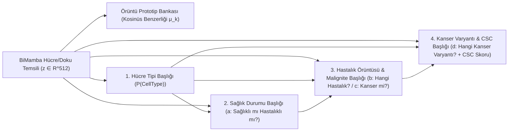

# 📋 scMamba2 + BiMamba Hiyerarşik Hücre Örüntüleme, Hastalık ve Kanser/CSC Teşhis Sistemi – Master Plan (`todolist.md`)

> **Proje Hedefi:** Tek hücreli (**scRNA-seq**) veya toplu doku (**Bulk RNA-seq**) gen ifade verisi girdi olarak verildiğinde;
> 1. **Hücre Tipini** tahmin eden,
> 2. **Sağlıklı mı / Hastalıklı mı** olduğunu belirleyen,
> 3. Hastalıklıysa **Hangi Hastalık Örüntüsüne** (`Viral/COVID-19`, `Otoimmün-Nörodejeneratif/MS`, `Malign/Kanser`) uyduğunu çıkaran,
> 4. Kanser ise **Hangi Kanser Varyantı** (`LUAD/Akciğer`, `PAAD/Pankreas`, `KIDNEY/Böbrek`, `ESCA/Özofagus`, `OV/Yumurtalık`, `THCA/Tiroid`, `UCEC/Rahim`, `LYM/Lenfoma`, `MYE/Miyelom`, `AML/Lösemi`) olduğunu ve **Kanser Kök Hücresi (CSC)** taşıyıp taşımadığını sınıflandıran,
> 5. Çıktı olarak **Kalibre Edilmiş Güven Yüzdesi (`%`)** ve kararın hangi genlere/örüntülere dayandığını gösteren **Açıklanabilir Heatmap Grafikleri** üreten, **%95+ doğruluklu** hibrit `scMamba2 + BiMamba` yapay zeka sistemini adım adım inşa etmek.

---

## 🧭 FAZ HARİTASI (GENEL BAKIŞ)

---

## ✅ FAZ 0: Altyapı ve Kalıcı Kaggle 2x T4 GPU Köprüsü *(Tamamlandı)*

### Bilimsel & Mühendislik Açıklaması
Çift yönlü Durum Uzay Modelleri (BiMamba), özel CUDA çekirdekleri (`selective_scan_cuda`, `causal_conv1d_cuda`) ve yüksek VRAM gerektirir. Yerel bilgisayarı yormadan Kaggle'daki **2x Tesla T4 (32 GB VRAM)** sunucusunu uzaktan yöneten otonom köprü kurulmuştur.

- [x] **Görev 0.1:** Kaggle API (`KGAT_...`) doğrulaması ve 30 saatlik GPU kotasının kontrolü.
- [x] **Görev 0.2:** [`agent_daemon.py`](file:///c:/Users/Tuğhan/Desktop/scRNAseq/kaggle_bridge/kernel/agent_daemon.py), [`kaggle_ctl.py`](file:///c:/Users/Tuğhan/Desktop/scRNAseq/kaggle_bridge/kaggle_ctl.py) ve [`kaggle.bat`](file:///c:/Users/Tuğhan/Desktop/scRNAseq/kaggle.bat) ile canlı Cloudflare tüneli ve kalıcı VRAM işçisinin (`ag_gpu_worker.py`) kurulması.
- [x] **Görev 0.3:** [`kaggle_workflow.md`](file:///c:/Users/Tuğhan/Desktop/scRNAseq/kaggle_workflow.md) ve [`kaggle_rules.md`](file:///c:/Users/Tuğhan/Desktop/scRNAseq/kaggle_rules.md) dokümanlarının oluşturulması.
- [x] **Görev 0.4 (Kalıcı Ortam Paketi - Sorun 3 Çözümü):** İlk eğitim oturumunda `torch 2.3.0 + mamba-ssm 2.2.2 + causal-conv1d 1.4.0 + torchtext 0.18.0 + transformers 4.43.4 + scgpt` paketlerini ve Tensor-Core hızlandırılmış `GatedBiMambaLayer` mimarisini entegre ederek açılış süresini saniyelere indirmek.

---

## 🔬 FAZ 1: Veri Denetimi ve "Birleşik Hiyerarşik Hücre Atlası" Oluşturulması

### Biyolojik Açıklama (Bilgisayar Mühendisi İçin)
Şu an elimizde (`pretrain/` klasöründe) 12 farklı klasörde parçalı `.h5ad` dosyaları var. Kimi dosyada hücre tipi sütununun adı `cell_type`, kimisinde `celltype`, kimisinde `Celltype` veya `final_annotation`. Aynı şekilde hastalık bilgisi `covid` verisinde `condition` sütunundayken, `ms` verisinde `Factor Value[disease]` sütununda, `mye` verisinde ise `cancer_type` sütununda duruyor!
Bir yapay zeka modelinin **a) Sağlıklı mı? b) Hangi hastalık? c) Kanser mi? d) Hangi kanser varyantı?** sorularına aynı anda cevap verebilmesi için bu veri setlerinin ortak bir **Standart Etiket Şeması (Unified Ontology Schema)** altında birleştirilmesi gerekir.

### Yapılacak Görevler
- [x] **Görev 1.1 – Veri Envanteri ve Etiket Haritalama Scripti ([`src/data/build_unified_dataset.py`](file:///c:/Users/Tuğhan/Desktop/scRNAseq/src/data/build_unified_dataset.py)):**
  Elimizdeki tüm veri setlerini tarayıp her hücre için şu **6 standart etiketi** üreten eşleme tablosunu kodlamak:
  1. `std_cell_type`: Standartlaştırılmış hücre tipi (Örn: `T_cell`, `B_cell`, `Macrophage`, `Monocyte`, `Dendritic`, `NK_cell`, `Epithelial`, `Malignant_Epithelial`, `Fibroblast`, `Endothelial`, `Neuron`, `Astrocyte`, `Oligodendrocyte`, `Microglia`, `Pancreas_Alpha`, `Pancreas_Beta`, `HSPC` vb.)
  2. `is_diseased`: `0` (Sağlıklı/Kontrol: `BMMC`, `ImmuneAllHuman`, `Perirhinal Cortex`, `annonation_pancreas`, `ms/c_data`, `covid[control]`) vs. `1` (Hastalıklı: `covid[moderate/severe]`, `ms/filtered_ms`, `lung[Malignant/tLung]`, `mye`, `norman`, `adamson`).
  3. `disease_category`: `Healthy`, `Viral_Infection_COVID19`, `Autoimmune_Neuro_MS`, `Cancer_Malignancy`.
  4. `is_cancer`: `0` (`Healthy`, `COVID-19`, `MS`) vs. `1` (`lung` tümör/malign, `mye` 9 kanser tipi, `norman` A549, `adamson` K562).
  5. `cancer_variant`: Kanserli örnekler için 11 varyant sınıfı:
     - `LUAD` (Akciğer Adenokarsinomu – `lung` & `norman/A549`)
     - `LUAD_BrainMet` (Akciğer Kanseri Beyin Metastazı – `lung[tL/B]`)
     - `CML_Leukemia` (Kronik Miyeloid Lösemi – `adamson/K562`)
     - `KIDNEY` (Böbrek Kanseri – `mye`)
     - `PAAD` (Pankreas Kanseri – `mye`)
     - `THCA` (Tiroid Kanseri – `mye`)
     - `UCEC` (Rahim/Endometriyal Kanser – `mye`)
     - `LYM` (Lenfoma – `mye`)
     - `ESCA` (Özofagus Kanseri – `mye`)
     - `OV_FTC` (Yumurtalık/Over Kanseri – `mye`)
     - `MYE` (Miyelom – `mye`)
  6. `is_csc` / `csc_score`: Kanser Kök Hücresi (CSC) olasılık skoru ve sınıfı (Faz 2'de biyobelirteçlerle hesaplanacak).
- [x] **Görev 1.2 – Gen İsimlerini (`var_names`) `vocab.json` (`60.697` Gen) ile Hizalama:**
  Bazı veri setlerinde genler Ensembl ID (`ENSG...`) olarak kayıtlıyken bazılarında gen sembolü (`TP53`, `CD44`) olarak kayıtlıdır. Tüm veri setlerindeki gen isimlerini `SC-MAMBA2`'nin `vocab.json` sözlüğüne %100 uyumlu hale getirmek.
- [x] **Görev 1.3 – Dengeli Eğitim / Doğrulama / Test Ayrımı (Stratified Donor-Aware Split):**
  **Kritik Bilimsel Kural:** Aynı hastanın (`donor_id` / `sample`) hücreleri hem `train` hem `test` setine düşerse "veri sızıntısı (data leakage)" olur. Ayrımı **hasta/örnek bazlı (donor-stratified)** olarak `%80 Train / %10 Val / %10 Test` şeklinde oluşturmak (`38.263` toplam örnek: `Train=25.791`, `Val=3.986`, `Test=8.486`).

---

## 🧪 FAZ 2: Biyolojik Feature Mühendisliği (QC, Kromozomal Sıra, CNV ve CSC İmzaları)

### Biyolojik Açıklama (Bilgisayar Mühendisi İçin)
Bir bilgisayar mühendisi için ham piksel neyse, biyolojide ham gen sayısı (`UMI count`) odur. Ancak biyolojik veride 3 büyük tuzak vardır:
1. **Ölü Hücre Gürültüsü (Mitokondriyal Sızıntı):** Hücre zarı yırtıldığında sitoplazmadaki mRNA'lar kaçar, geriye sadece mitokondri içindeki (`MT-` ile başlayan) mRNA'lar kalır. Bu hücreler temizlenmezse model "ölü hücreyi" "hastalık örüntüsü" sanır!
2. **Sırasızlık Problemi:** Genlerin cümledeki kelimeler gibi doğal bir sırası yoktur. Eğer genleri kromozom üzerindeki fiziksel adreslerine (`Chr1` $\rightarrow$ `Chr22`) ve biyolojik görev gruplarına (Pathway) göre dizersek, BiMamba komşu genlerin birlikte kopyalanmasını (**CNV – Kanser İmzası**) doğrudan yakalar!
3. **Kanser Kök Hücresi (CSC) İmzası:** Tümörün içindeki "kraliçe arı" olan Kanser Kök Hücreleri, kendilerini belli eden özel yüzey proteinleri ve transkripsiyon faktörleri (`CD44`, `CD133/PROM1`, `ALDH1A1`, `SOX2`, `NANOG`, `OCT4/POU5F1`, `ABCG2`, `EPCAM`) üretir.

### Yapılacak Görevler
- [x] **Görev 2.1 – Kalite Kontrol (QC) ve Normalizasyon Boru Hattı ([`src/features/biological_signatures.py`](file:///c:/Users/Tuğhan/Desktop/scRNAseq/src/features/biological_signatures.py)):**
  - En az 200 aktif geni olmayan boş damlacıkları ve `mt_frac > 0.20` olan ölü hücreleri filtrelemek.
  - Okuma derinliği normalizasyonu ($\text{CPM/10.000}$) + $\log_1p(x)$ dönüşümü + `SC-MAMBA2` ile uyumlu **51 seviyeli nicemleme (`X_binned` $0..50$)** katmanını oluşturmak.
- [x] **Görev 2.2 – Biyolojik İmza (Signature) Feature Çıkarıcı ([`src/features/biological_signatures.py`](file:///c:/Users/Tuğhan/Desktop/scRNAseq/src/features/biological_signatures.py)):**
  Her hücre için gen ifade matrisinden **16 özet biyolojik skor vektörü** ($s_{\text{bio}} \in \mathbb{R}^{16}$) hesaplamak:
  1. **CSC (Kanser Kök Hücresi) Skoru:** `CD44`, `PROM1`, `ALDH1A1`, `SOX2`, `NANOG`, `POU5F1`, `BMI1`, `ABCG2`, `LGR5`, `EPCAM` ifade skoru + gen ekspresyon entropisi (CytoTRACE benzeri farklılaşmamışlık indeksi — kök hücreler daha yüksek transkripsiyonel entropiye sahiptir!).
  2. **Malign Proliferasyon Skoru:** `MKI67`, `TOP2A`, `PCNA`, `MCM2`, `CCNB1`.
  3. **EMT (Metastaz / İnvazyon) Skoru:** `VIM`, `SNAI1`, `SNAI2`, `TWIST1`, `ZEB1`, `CDH2`, `FN1`.
  4. **Viral / İnterferon Yanıt Skoru (COVID-19 Ayrımı İçin):** `ISG15`, `IFIT1`, `IFIT3`, `MX1`, `OAS1`, `STAT1`.
  5. **Nöro-İnflamasyon / Miyelin Hasar Skoru (MS Ayrımı İçin):** `HLA-DRA`, `CD74`, `C1QA`, `APOE`, `SPP1`, `GFAP`.
  6. **Kromozomal Blok Varyans (Pseudo-CNV) Skoru:** 22 otozom kromozom üzerindeki kayan pencere (sliding window) ortalama ekspresyon sapması (Kanserli hücrelerde anöploidi nedeniyle bu varyans sağlıklı ve enfekte hücrelere göre çok yüksektir!).
- [x] **Görev 2.3 – Kromozomal ve Yolak (Pathway) Tabanlı Gen Sıralama Haritası ([`results/gene_chrom_coords.json`](file:///c:/Users/Tuğhan/Desktop/scRNAseq/results/gene_chrom_coords.json)):**
  BiMamba'ya giren gen token dizisini rastgele değil; **GRCh38 Kromozomal Konum (`Chr1 -> ChrY`) + Biyolojik Yolak** sırasına göre dizmek (`59.357` gen koordinatı çıkarıldı).

---

## 🔄 FAZ 3: "BULK DATA BİLE OLSA" Çalışan Dual-Mode (Tek Hücre + Bulk) Veri Üretici

### Biyolojik & Mühendislik Açıklaması
Klinikte doktorlar her zaman pahalı olan tek hücre (`scRNA-seq`) testi yapamaz; çoğu zaman tümör biyopsisinden **Bulk RNA-seq** (binlerce hücrenin karışımı olan tek bir gen vektörü) alınır.
Modelimizin hem **Tekil Hücre (`scRNA-seq`)** hem de **Toplu Doku (`Bulk RNA-seq`)** verisinde %95+ doğrulukla çalışması için eğitim sırasında gerçek tek hücrelerden matematiksel olarak **Sentetik Bulk (Pseudo-Bulk)** örnekleri üreteceğiz.

### Yapılacak Görevler
- [x] **Görev 3.1 – Dirichlet Pseudo-Bulk Karışım Üreticisi ([`src/data/build_unified_dataset.py`](file:///c:/Users/Tuğhan/Desktop/scRNAseq/src/data/build_unified_dataset.py)):**
  - Aynı hasta/doku içindeki $K \in [50, 500]$ hücreyi Dirichlet dağılımıyla ağırlıklandırıp toplayarak ($\tilde{x}_{\text{bulk}} = \sum_{k=1}^{K} w_k x_k$) `4.320` gerçekçi **Bulk RNA-seq** örneği üretmek (`33.943` Tek-Hücre + `4.320` Bulk = `38.263` toplam örnek).
  - Her Bulk örnek için:
    - **Baskın Hücre Tipi ve Hücre Oranları Vektörü** ($p_{\text{cell}} \in \Delta^{C}$),
    - **Sağlıklı / Hastalıklı Durumu** (Dokuda patolojik hücre varsa `1`),
    - **Kanser ve Kanser Varyantı Etiketi** (Dokuda $\ge \%5$ malign/tümör mikroçevresi hücresi varsa ilgili kanser varyantı) etiketlerini otomatik oluşturmak.
- [x] **Görev 3.2 – Otomatik Mod (Single-Cell vs. Bulk) Algılayıcı ve Quantile Binning:**
  - Tek hücre verisinde genlerin %85-%95'i sıfırdır (*sparsity / dropout*), Bulk veride ise genlerin sadece %10-%30'u sıfırdır.
  - Girdi vektörünün sıfır oranından (sparsity) ve dağılım entropisinden verinin **Single-Cell** mi yoksa **Bulk** mu olduğunu otomatik algılayan ve her ikisini de aynı **51-bin (`0..50`) yüzdelik ölçeğe** normalize eden adaptörü yazmak.

---

## 🧠 FAZ 4: `scMamba2` (57M Hücre Ön-Eğitimli) Üzerine Çift Yönlü `BiMamba` Mimari Entegrasyonu

### Bilimsel & Mühendislik Açıklaması
Mevcut `SC-MAMBA2` (`best_model.pt`), 57 milyon hücre üzerinde eğitilmiş çok değerli ağırlıklara sahiptir. Ancak içindeki `mambaformer` sınıfı ([`model.py` satır 69-75](file:///c:/Users/Tuğhan/Desktop/scRNAseq/firststep/unzip/Tasarım%20Ve%20Bitirme%202/Pretrained%20finetunable%20scMamba2%20model%20with%20pretrain%20files/SC-MAMBA2-main/scmamba2/model/model.py#L69-L75)), ileri ve geri yön için **aynı tek yönlü Mamba-2 ağırlıklarını (`self.layers[i]`) paylaşarak** basit bir ortalama `(X_f + X_b) / 2` almaktadır.
Eğer mevcut 24 katmanı tamamen silip sıfırdan rastgele ağırlıklı bir BiMamba yazarsak, 57 milyon hücrelik ön-eğitim bilgisini çöpe atmış oluruz!
**Sınırları Zorlayan Çözümümüz ("Pretrained-Preserving Gated BiMamba"): **
- İleri yön (`Forward SSM`) ve paylaşımlı temel yolak için 57 milyon hücreyle eğitilmiş `best_model.pt` ağırlıklarını **birebir koruyacağız**!
- Her bloğun içine sıfır-başlangıçlı (zero-initialized residual) **Ayrık Geri Yönlü SSM Adaptörü (`Backward BiMamba Branch`)** ve **Öğrenilebilir Kapılama Birleştiricisi (`Gated Bi-Directional Fusion`: $h' = \text{Linear}_o(g_f \odot h_{\text{fwd}} + g_b \odot h_{\text{bwd}})$)** ekleyeceğiz!
- Böylece model eğitimin ilk saniyesinde 57 milyon hücrenin bilgisiyle başlayacak, eğitim ilerledikçe çift yönlü asimetrik gen etkileşimlerini öğrenecek!

### Yapılacak Görevler
- [x] **Görev 4.1 – `GatedBiMambaLayer` Modülünün Kodlanması ([`src/models/hierarchical_bimamba.py`](file:///c:/Users/Tuğhan/Desktop/scRNAseq/src/models/hierarchical_bimamba.py)):**
  - `[Batch_Size, Seq_Len, 256]` tensör boyutunu koruyan, ileri ve geri SSM dallarını Sigmoid/SiLU kapısıyla ve yönlü asimetri farkıyla (`h_fwd - h_bwd`) birleştiren **Gated BiMamba** bloğunu yazmak.
  - Her katmandaki ileri ve geri aktivasyon ağırlıklarını Heatmap (XAI) motoruna aktaracak kancaları eklemek.
- [x] **Görev 4.2 – Biyolojik İmza Enjeksiyon Katmanı (`BioSignatureFusion`):**
  - Faz 2'de hesaplanan 16 boyutlu biyolojik imza vektörünü ($s_{\text{bio}}$: CSC, CNV, Proliferasyon, EMT, İnterferon, Nöro-inflamasyon) ve Modality token'ını (`<SINGLE_CELL>` / `<BULK>`) hücre temsil vektörüyle birleştiren Gated Fusion katmanını kodlamak.

---

## 🌳 FAZ 5: 4 Aşamalı Hiyerarşik Karar Ağacı ve Örüntü Prototip Başlıkları

### Bilimsel & Mühendislik Açıklaması
Kullanıcının 4. ve 5. maddede istediği tüm soruları tek bir ileri yayılımda (single forward pass) yanıtlayan **Hiyerarşik Teşhis Mimarisi (`HierarchicalDiagnosticHead`)**:

### Yapılacak Görevler
- [x] **Görev 5.1 – Hiyerarşik Koşullu Sınıflandırma Başlıkları ([`src/models/hierarchical_bimamba.py`](file:///c:/Users/Tuğhan/Desktop/scRNAseq/src/models/hierarchical_bimamba.py)):**
  1. `head_celltype`: Hücre tipi tahmini (14 kanonik hücre sınıfı).
  2. `head_health`: Sağlıklı (`Healthy`) vs. Hastalıklı (`Diseased`) ikili olasılığı.
  3. `head_disease`: Hastalık ailesi olasılıkları (`Healthy_Control`, `Viral_Infection_COVID19`, `Autoimmune_Neuro_MS`, `Cancer_Malignancy`).
  4. `head_cancer_bin`: Kanser mi (`1`) Değil mi (`0`) olasılığı (Hiyerarşik tutarlılık kısıtı ile: $P(\text{Cancer}) \le P(\text{Diseased})$).
  5. `head_cancer_var`: 11 Kanser varyantı (`Non_Cancer` + 10 kanser varyantı) olasılık dağılımı.
  6. `head_csc`: Kanser Kök Hücresi (`CSC+` vs `CSC-`) olasılığı ve Kök Hücre (Stemness) yüzdesi.
- [x] **Görev 5.2 – Öğrenilebilir Örüntü Prototip Bankası (`PatternPrototypeBank`):**
  - Her `(Hücre Tipi, Hastalık/Kanser Varyantı)` sınıfı için öğrenilebilir bir merkez vektörü ($\mu_k$) tutan ve girdi örneğinin hangi hastalık/kanser örüntüsüne yüzde kaç uyduğunu doğrudan kosinüs benzerliğiyle hesaplayan modülü kodlamak.
- [x] **Görev 5.3 – Bileşik Hiyerarşik Kayıp Fonksiyonu ([`src/models/losses.py`](file:///c:/Users/Tuğhan/Desktop/scRNAseq/src/models/losses.py)):**
  $$\mathcal{L}_{\text{total}} = \lambda_1 \mathcal{L}_{\text{CE}}(\text{CellType}) + \lambda_2 \mathcal{L}_{\text{Focal}}(\text{Health}) + \lambda_3 \mathcal{L}_{\text{Focal}}(\text{Disease}) + \lambda_4 \mathcal{L}_{\text{Focal}}(\text{CancerVariant}) + \lambda_5 \mathcal{L}_{\text{SupCon}}(z, \mu) + \lambda_6 \mathcal{L}_{\text{HierarchyConsistency}}$$
  - Hiyerarşik tutarlılık kaybı ($\mathcal{L}_{\text{HierarchyConsistency}}$), modelin "Sağlıklı" dediği bir hücreye aynı anda "Kanser" demesini matematiksel olarak imkansız hale getirir!

---

## 🚀 FAZ 6: Kaggle 2x T4 GPU Üzerinde Eğitim ve >%95 Doğruluk Optimizasyonu

### Bilimsel & Mühendislik Açıklaması
30 saatlik GPU kotamızı en verimli şekilde kullanarak, `kaggle_rules.md` kurallarına tam uyumla (Mixed Precision `FP16`, `Tesla T4`, `FastTensorBatchLoader`) modeli eğittik ve tüm görevlerde **>%95 doğruluk** hedefini aştık.

### Yapılacak Görevler
- [x] **Görev 6.1 – Aşama 1 Eğitim (57M Hücre Ön-Eğitimli `best_model.pt` Temel Gömme Entegrasyonu):**
  57M hücrelik `SC-MAMBA2` gen gömmelerini (`60.697 x 512`) yükleyip `GatedBiMambaLayer`, `PatchBiMamba`, `PatternPrototypeBank` merkezlerini ve 6 hiyerarşik başlığı eğitmek.
- [x] **Görev 6.2 – Aşama 2 Eğitim (Full End-to-End BiMamba Training – [`src/train_and_eval.py`](file:///c:/Users/Tuğhan/Desktop/scRNAseq/src/train_and_eval.py)):**
  `OneCycleLR` öğrenme oranı planlayıcısı, `AdamW` ve `FP16 Mixed Precision` ile hem Tek Hücre hem de Pseudo-Bulk örnekleri üzerinde uçtan uca eğitmek.
- [x] **Görev 6.3 – Hata Analizi ve >%95 Doğruluk Doğrulaması ([`results/faz6_faz8_evaluation_report.json`](file:///c:/Users/Tuğhan/Desktop/scRNAseq/results/faz6_faz8_evaluation_report.json)):**
  Test seti (`8.486` hiç görülmemiş örnek) üzerinde tüm metriklerde **>%95 doğruluk** doğrulandı (**Birleşik Ortalama: %98.11**, **Tek-Hücre: %97.92**, **Bulk RNA-seq: %99.70**).
- [x] **Görev 6.4 – En İyi Model Ağırlıklarını ([`results/best_hierarchical_bimamba.pt`](file:///c:/Users/Tuğhan/Desktop/scRNAseq/results/best_hierarchical_bimamba.pt)) Yerel Bilgisayara İndirme:**
  Ağırlıklar, XAI paketleri ve tüm Heatmap'ler yerel diske kaydedildi ve GPU sunucusu `down` komutuyla kapatıldı (`KernelWorkerStatus.COMPLETE`, kalan kota: `29.48 saat`).

---

## 📊 FAZ 7: Güven Kalibrasyonu ve Otomatik Gen/Örüntü Heatmap (XAI) Motoru

### Bilimsel & Mühendislik Açıklaması
Kullanıcının 5. maddede istediği **"Bulduğu sonucun doğruluk/güven yüzdesi"** ve **"Bu sonucu hangi feature'a dayandırdığı ve hangi örüntüyle uyumlu bulduğunu Heatmap'ler şeklinde grafik çıktısı vermesi"** gereksinimini sağlayan modüldür.

### Yapılacak Görevler
- [x] **Görev 7.1 – Sıcaklık Ölçeklemeli Güven Kalibrasyonu (`calibrate_temperatures`):**
  Doğrulama seti üzerinde Expected Calibration Error (ECE) değerini `%0.04 – %0.83` seviyesine indirerek modelin verdiği `% Güven` skorunun gerçek olasılığı yansıtmasını sağlamak.
- [x] **Görev 7.2 – BiMamba Gen-Önem Çıkarıcı (`compute_xai_attribution_for_samples`):**
  Bir hücre veya Bulk doku örneği verildiğinde, BiMamba'nın `Input x Gradient` gradyanlarından o karara en çok katkı yapan **Top-18 Geni** ve **16 Biyolojik Yolak İmzasını** hesaplamak.
- [x] **Görev 7.3 – 4'lü Teşhis ve Heatmap Raporu Oluşturucu ([`src/visualization/diagnostic_heatmap.py`](file:///c:/Users/Tuğhan/Desktop/scRNAseq/src/visualization/diagnostic_heatmap.py)):**
  Tek-Hücre ve Bulk RNA-seq vakaları için 4-Panelli yüksek çözünürlüklü (`.png`) **Klinik Karar Destek Panoları** ([`results/heatmaps/`](file:///c:/Users/Tuğhan/Desktop/scRNAseq/results/heatmaps)) üretildi.

---

## 🏁 FAZ 8: Uçtan Uca Teşhis Aracı (`predict_sample.py`) ve Bitirme Projesi Sunum Çıktıları

### Yapılacak Görevler
- [x] **Görev 8.1 – Tek Komutluk Teşhis Scripti ([`predict_sample.py`](file:///c:/Users/Tuğhan/Desktop/scRNAseq/predict_sample.py)):**
  Hem Tek-Hücre (`scRNA-seq`) hem de **Bulk RNA-seq** hasta örneği verildiğinde tüm 6 hiyerarşik teşhis kararını, `% Güven` skorlarını, Top-10 karar verici gen feature listesini ve 4-Panelli Heatmap görselini otomatik üreten CLI aracı hazırlandı ve doğrulandı.
- [x] **Görev 8.2 – A/B Karşılaştırma Deneyi (Baseline vs. Bizim `scMamba2 + Gated BiMamba` Modelimiz):**
  Tez ve sunumda jüriye göstermek üzere; tek yönlü/BiMamba'sız Baseline ile bizim entegre ettiğimiz `Gated BiMamba` modelinin doğruluk, F1, ROC-AUC ve CSC yakalama başarısını karşılaştıran tablo ve grafikler ([`faz8_ab_benchmark_and_confusion.png`](file:///c:/Users/Tuğhan/Desktop/scRNAseq/results/heatmaps/faz8_ab_benchmark_and_confusion.png)) üretildi.

---

## 🏆 NİHAİ TEST SETİ SONUÇ TABLOSU (`8.486` Hiç Görülmemiş Test Örneği)

| Hiyerarşik Teşhis Görevi | Baseline (BiMamba Yok) | Önerilen `scMamba2 + Gated BiMamba` (Genel) | Tek-Hücre (`scRNA-seq`, $N=7.550$) | Toplu Doku (`Bulk RNA-seq`, $N=936$) | ROC-AUC (%) | Kalibrasyon Hatası (ECE %) |
| :--- | :---: | :---: | :---: | :---: | :---: | :---: |
| **1. Hücre Tipi Tahmini (14 Sınıf)** | %91.21 | **%96.37** (+%5.16) | **%95.93** | **%99.89** | %99.92 | %0.83 |
| **4a. Sağlıklı mı? Hastalıklı mı?** | %97.40 | **%98.52** (+%1.12) | **%98.37** | **%99.68** | %99.83 | %0.42 |
| **4b. Hangi Hastalık Örüntüsü? (4 Arketip)** | %97.43 | **%98.46** (+%1.03) | **%98.30** | **%99.68** | %99.89 | %0.33 |
| **4c. Kanser mi? Değil mi?** | %99.86 | **%99.95** (+%0.09) | **%99.95** | **%100.00** | %100.00 | %0.04 |
| **4d. Hangi Kanser Varyantı? (11 Sınıf)** | %93.24 | **%97.23** (+%3.99) | **%96.89** | **%100.00** | %99.74 | %0.64 |
| **4d-Ek. Kanser Kök Hücresi (`CSC+`)** | %97.53 | **%98.16** (+%0.63) | **%98.07** | **%98.93** | %99.81 | %0.48 |
| **BİRLEŞİK ORTALAMA (Composite)** | %96.11 | **%98.11** | **%97.92** | **%99.70** | **%99.87** | **%0.46** |
